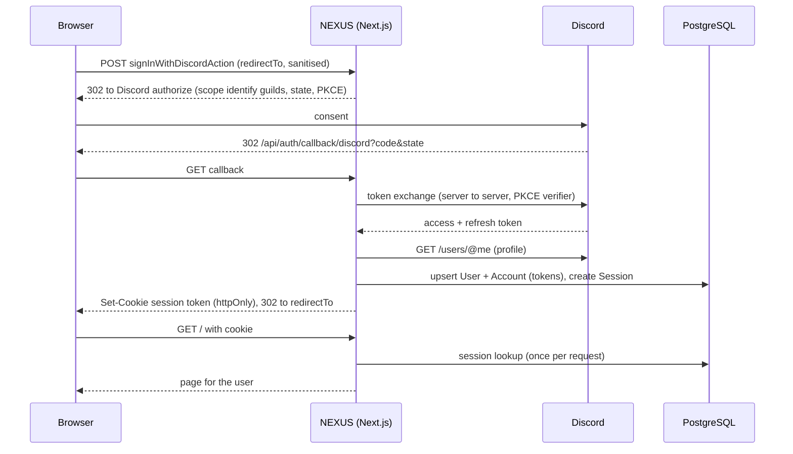

# Architecture

NEXUS is a single npm package (no workspaces) containing a Next.js web app and a
Discord bot process that share the same database.

## Directory layout

```
src/
  app/            Routes only (thin). Pages, layouts, route handlers.
    (app)/        Route group with the app shell layout
      (protected)/  Signed-in pages: / (Overview), /onboarding, and the
                    placeholder pages for sections that are not built
      demo/         Public demo dashboard (sample data)
    login/        Public sign-in page
    api/auth/     Auth.js route handlers
    api/health/   Liveness probe
    api/ready/    Readiness probe (checks the database)
  components/
    ui/           shadcn/ui primitives (generated/owned code)
    layout/       App shell: sidebar, header, navigation
    common/       Shared building blocks: StatCard, ChartCard, EmptyState, ...
  features/<f>/   Feature modules: components, queries, types for one domain
                  (e.g. dashboard). Routes import from here.
  lib/            Shared, framework-agnostic utilities (cn, env, ...)
  server/db/      Prisma client singleton + DB helpers. server-only.
  server/auth/    Auth.js config, current-user helpers. server-only.
  server/discord/ Discord API client, token refresh, eligibility. server-only.
  server/communities/  Tenant-isolated community reads, selection, active cookie.
  server/activity/     Read side of the bot's data: activity summary, recent
                       events, the Overview loader. server-only.
  config/         Static app config (site name, nav, ...)
  generated/      Prisma client output. Gitignored; created by `prisma generate`.
  bot/            Discord bot process (own entrypoint, not part of Next.js)
prisma/           schema.prisma and migrations/
tests/            Vitest tests, mirroring src/ paths
docs/             Project documentation
```

## Layers and dependency rules

```
app (routes) -> features -> components, lib, server
components   -> lib            (never server/, never features/)
features     -> components, lib, server/* (server components/actions only)
server/*     -> lib (env), generated/prisma, other server/* (see below)
bot          -> server/db/prisma (the Prisma core), lib, generated/prisma
                (never app/, components/, server/db index, server/auth, next/*)
```

- Routes stay thin: parse input, call a feature function, render.
- Anything touching the database imports from `@/server/db`, which starts with
  `import "server-only"`, so a client component importing it fails the build.
- Path alias: `@/*` maps to `src/*`.

## Data flow (current)

```
Browser -> Next.js route (src/app) -> [feature code] -> server/* -> getDb() -> PostgreSQL
                                                          \-> Discord API (user's token)

Discord Gateway -> bot handlers -> bot services -> batch writer -> PostgreSQL
                                       \-> heartbeat / installation -> communities
```

Signed-in pages read the session, memberships and (onboarding only) Discord. The
public demo renders **demo data** from a feature-level fixture and reads nothing
but the session cookie in the header.

## Environment handling

`src/lib/env.ts` validates server variables with Zod, but **lazily**: `getEnv()`
parses `process.env` on first call and memoises it. Nothing validates at import
time, so `next build` and pages that never touch the database work without
`DATABASE_URL`. Error messages list variable names only, never values.

## Database access

- `getDb()` (`src/server/db/client.ts`) creates the Prisma client on first use
  with the `@prisma/adapter-pg` driver adapter (required by Prisma 7). In
  non-production it is cached on `globalThis` so hot reloads reuse one pool.
- `prisma.config.ts` holds CLI configuration (schema path, migrations path,
  datasource URL). It loads `.env` itself because Prisma 7 no longer does.
- The generated client lives in `src/generated/prisma` (gitignored,
  regenerated on `postinstall`).

## Health and readiness

| Endpoint          | Purpose   | Touches DB | Success                    | Failure                      |
| ----------------- | --------- | ---------- | -------------------------- | ---------------------------- |
| `GET /api/health` | Liveness  | No         | `200 {status:"ok",...}`    | n/a                          |
| `GET /api/ready`  | Readiness | `SELECT 1` | `200 {status:"ready",...}` | `503 {status:"unavailable"}` |

`pingDatabase()` applies a 2 s timeout and converts every failure (invalid env,
connection refused, timeout) into `false`, so the response never exposes
connection strings or driver errors. Both routes are `force-dynamic`.

## Authentication and authorization

Phase 2 adds Discord sign-in (Auth.js v5), community selection and the
protection model. Decisions: ADR-015 to ADR-024 in [DECISIONS.md](DECISIONS.md).

### Layering

```
app (routes) -> features/{auth,communities} -> server/{auth,communities,discord}
server/communities -> server/discord -> server/db
server/auth        -> server/db, lib/env
```

| Module                 | Responsibility                                                                                                                                                                                              |
| ---------------------- | ----------------------------------------------------------------------------------------------------------------------------------------------------------------------------------------------------------- |
| `server/auth`          | Auth.js config (`config.ts`), `getCurrentUser()` / `requireUser()` (`user.ts`), the public session shape (`session.ts`), the profile mapper, the sign-in sync.                                              |
| `server/discord`       | Discord I/O with the user's own token: `api.ts` (guild list, Zod-validated, never throws), `tokens.ts` (refresh), `permissions.ts` (BigInt eligibility), `guilds.ts` (annotated eligible guilds), `cdn.ts`. |
| `server/communities`   | Tenant-isolated reads (`queries.ts`), `selectCommunity` (`select.ts`), the active-community cookie (`active.ts`).                                                                                           |
| `features/auth`        | `signInWithDiscordAction`, `signOutAction`, `redirect.ts` (same-site path guard), `login-errors.ts`, `UserMenu`, `HeaderAccount`, `DiscordSubmitButton`.                                                    |
| `features/communities` | `selectCommunityAction`, `switchActiveCommunityAction`, `OnboardingView`, `GuildCard`, `GuildSelectForm`, `CommunityOverview`.                                                                              |

All of `src/server/*` starts with `import "server-only"`; a client component that
imports it fails the build. Client components only ever receive plain display
data (a name, an image URL, community ids and names): never a token, a session
or an account row.

### Sign-in flow



The consent, callback, token exchange and profile fetch are Auth.js's; NEXUS adds
the `events.signIn` sync (refresh the stored tokens and the profile on every
sign-in, because Auth.js only does so on the first) and the whitelisted session
callback. The steps from the consent screen onward have **not** been exercised
against real Discord yet (see [PROGRESS.md](PROGRESS.md)).

### Session strategy

Database sessions (`session.strategy = "database"`, 30 days, `updateAge` 1 day).
The cookie holds only an opaque session token; the row lives in `sessions` and is
deleted on sign-out, so a session can be revoked server-side. The `session`
callback builds `{ user: { id, name, image }, expires }` from scratch (never a
spread of the adapter's objects). Cost: one indexed read per request,
deduplicated with React `cache`. `getCurrentUser()` and `requireUser()` call
`connection()` first so these routes are never prerendered.

### Discord token storage and refresh

Access and refresh tokens live in the `accounts` table (plain text, as the Auth.js
adapter does; encryption at rest is future hardening). They are read only by
`server/discord/tokens.ts`. `getValidDiscordAccessToken(userId)` refreshes 60
seconds before expiry, stores the rotated pair in one update, and on
`invalid_grant` re-reads the row in case a concurrent request already rotated it.
When nothing usable is left it answers `reauth_required` and the UI offers
"Reconnect Discord". Tokens are never logged, returned to components or put in
the session.

### Tenant isolation

A community is reachable only through a membership row of the signed-in user:
`listUserCommunities(userId)` and `getUserCommunity(userId, communityId)` are the
only read paths; there is no "get by id" without a user. `selectCommunity` trusts
nothing from the browser: it validates the id as a snowflake, re-fetches the
user's guilds from Discord and requires owner / Administrator / Manage Server,
then writes only the caller's own membership. `switchActiveCommunityAction` makes
no Discord call and accepts only ids found through the caller's memberships
(ADR-023).

### Active community cookie

`nexus_community` is httpOnly, `SameSite=Lax`, `Secure` in production, one year.
It is only a hint: `getActiveCommunity(userId)` re-validates it against the
memberships on every call (a forged or stale id is ignored) and falls back to the
most recently joined membership, then to null (which sends the user to
`/onboarding`).

### Route protection model

There is no `proxy.ts` (ADR-016): a proxy cannot check a database session without
a round trip per request, and a cookie-presence check would only be UX.

- Public: `/login`, `/demo`, `/api/health`, `/api/ready`, `/api/auth/*`.
- Protected: everything in `src/app/(app)/(protected)/` (`/`, `/onboarding`, the
  five coming-soon pages). The group layout calls `requireUser()` as a first gate,
  but layouts are not re-rendered on client navigation, so **every protected page
  and every server action calls `requireUser()` itself**. When auth is not
  configured, `requireUser()` redirects to `/login?error=Configuration` (fail
  closed).
- `requireUser()` redirects to `/login`; `/login` redirects a signed-in user to
  `/`. Post-login destinations go through `safeRedirectPath` (same-site absolute
  paths only).
- Server actions are public POST endpoints: each re-checks the session and takes
  the user from it, never from form fields.

### Demo separation

`/demo` is the old dashboard on generated data, outside the protected group. It
is the only route that renders demo figures: `getDashboardData()` always returns
`source: "demo"`, the `DemoBanner` is part of that view, and `DemoIndicator`
(header badge) shows only when the pathname is `/demo` (ADR-022). A real
community's Overview (`CommunityOverview`) never receives or renders demo data; a
unit test asserts it contains no numbers and no "Demo data" text. Live data
arrives in Phase 4 for the real community's own page, not by pointing `/` at
demo data. Since Phase 3 the Overview shows real bot status and message counts
from the bot's own tables; those are real, never demo.

## Discord bot process

A long-running discord.js process in `src/bot/`, started separately from the web
server with `npm run bot:dev` / `bot:start` (`tsx`, ADR-026). Deploy it as a
second process or container from the same repo. The two processes share only the
database: the bot writes, the web reads, and neither calls the other.

### Data flow

```
Discord Gateway (intents Guilds + GuildMessages)
  -> handlers/    map discord.js objects to plain ids (no business logic)
  -> services/    allowlist, classify (keep 4 fields), ingestion, installation,
                  heartbeat; talk to a narrow BotRepository interface
  -> batch writer buffered, createMany skipDuplicates, retry with backoff
  -> PostgreSQL   message_events, communities.bot_connected_at / bot_last_seen_at
  -> src/server/activity (server-only)   counts, distinct authors, recent events
  -> Overview page (server component) -> CommunityOverview
```

Metadata only: message id, guild id, channel id, author id and timestamp are
stored; content, embeds, attachments and mentions are never read (ADR-027).

### Database boundary

`src/server/db/prisma.ts` is a framework-agnostic Prisma core with no
`server-only` import. The web uses it through `src/server/db` (`getDb()`, which
adds `server-only` so client bundles cannot reach it); the bot imports the core
directly, because `server-only` throws in plain Node (ADR-025).

### ESLint boundaries

- Client components cannot import `@/server/**` at runtime (type imports are OK).
- `src/app`, `src/server` and `src/lib` cannot import `@/bot/**`.
- `src/bot/**` may import only `@/server/db/prisma` from the server tree, never
  `next/*`, Auth.js, `server-only` modules or UI code.

### Bot status model

The bot writes two timestamps and never an "offline" flag. `getBotStatus`
(`src/lib/bot-status.ts`, pure) derives the state at read time:

| State           | Rule                                                             |
| --------------- | ---------------------------------------------------------------- |
| `not_installed` | `botConnectedAt` is null (never seen, or removed from the guild) |
| `online`        | installed and `botLastSeenAt` at most 3 minutes old              |
| `offline`       | installed, and no heartbeat or an older one                      |

The Overview loader (`getOverviewData`, ADR-031) obtains the community only from
`getActiveCommunity(userId)`, then runs activity queries scoped to that id. A
browser-supplied community id is never used. Database errors become a typed
error state rendered by the page.

### Invite link

`buildBotInviteUrl` (`src/lib/discord-invite.ts`) builds the authorize URL on the
server from the public OAuth Client ID (`AUTH_DISCORD_ID`) and the community's
guild id, with `scope=bot` and `permissions=1024` (View Channels). It is rendered
as a plain link; installation is confirmed only by the bot itself (ADR-029).

## Why no monorepo

One deployable product, one team, one set of types. Workspaces would add
tooling and versioning overhead without a second consumer that needs an
independent package. If the bot or a shared SDK later needs independent
release cycles, `src/lib` and `src/server` can be extracted into packages then
(see ADR-002 in [DECISIONS.md](DECISIONS.md)).

## Design system and UI

- Tailwind v4 is configured in CSS (`src/app/globals.css`, `@theme inline`);
  there is no `tailwind.config.js`.
- shadcn/ui (`components.json`, `cn()` in `src/lib/utils.ts`); components are
  added with the shadcn CLI into `src/components/ui` and restyled through
  tokens, not per-use overrides. Added so far: button, card, badge, sheet,
  separator, skeleton, avatar, chart, dropdown-menu (written by hand in the shadcn style on `radix-ui`). Local edits to generated files: the CLI
  emitted `import { cn } from "cn"` (fixed to `@/lib/utils`), `transition-all`
  became `transition-colors`, `Card` lost its shadow and got tighter padding,
  `CardTitle` renders an `h2`.

### Tokens

Declared once as `oklch()` on `:root` in `globals.css` and mapped to Tailwind
colors in `@theme inline`. Dark is the default and only theme (`<html
class="dark">` keeps shadcn `dark:` variants active). To add light later,
override the same variables under `:root[data-theme="light"]`; components do
not change.

| Token                            | Value (oklch / hex)           | Role                                                 |
| -------------------------------- | ----------------------------- | ---------------------------------------------------- |
| `background`                     | 0.145 0.012 285 / #09090f     | page canvas (elevation 0)                            |
| `sidebar`                        | 0.165 0.013 285 / #0e0e14     | chrome beside the canvas (1)                         |
| `card`                           | 0.19 0.014 285 / #13131a      | panels (2)                                           |
| `popover`                        | 0.23 0.016 285 / #1c1c24      | floating layers: sheet, chart tooltip (3)            |
| `muted` / `secondary` / `accent` | 0.235-0.28 x 285              | control fills and hover inside panels (4)            |
| `foreground`                     | 0.97 0.004 285 / #f5f5f8      | text, 17:1 on card                                   |
| `muted-foreground`               | 0.72 0.02 285 / #a3a3b1       | secondary text, 7.4:1 on card                        |
| `primary`                        | 0.55 0.21 292 / #794ddf       | brand violet; white text on it is 5.1:1              |
| `ring`                           | 0.72 0.17 292 / #a88dff       | focus ring, 7.5:1 on canvas                          |
| `border` / `input`               | 0.30 / 0.34 x 285             | 1px lines                                            |
| `chart-1` / `chart-2`            | violet #a88fff / cyan #50d9ef | membership series / activity series                  |
| `chart-3..5`                     | green / amber / pink          | reserved for future series                           |
| `signal`                         | 0.82 0.12 210 / #50d9ef       | cyan data accent                                     |
| `success` / `danger` / `warning` | green / coral / amber         | positive change / negative change text / demo notice |
| `destructive`                    | 0.55 0.20 25 / #cc272e        | destructive fills                                    |

Radius base is `0.625rem`. Layout variables: `--header-height`,
`--sidebar-width`. Accent use is deliberately small: the active nav item has a
2px violet bar, and the primary fill appears on the brand mark, buttons and
the skip link. Motion is limited to state changes; a global
`prefers-reduced-motion` rule shortens all animation and transition durations.

### Typography

Geist Sans and Geist Mono from the `geist` npm package (loaded through
`next/font/local`, so no network at build). Base size is 15px for app density;
metrics are 30px semibold with `tabular-nums`. Headings have slight negative
letter-spacing and `text-wrap: balance`. Labels are sentence case, never
tracked capitals.

### App shell

`src/app/(app)/layout.tsx` renders `AppShell` (`src/components/layout`):

- `Sidebar` (fixed, `lg` and up) and `MobileNav` (a `Sheet` drawer behind a
  header button below `lg`, closing when a link is followed) share `Brand` and
  `SidebarNav`.
- `SidebarNav` is the only nav client component (needs `usePathname` for
  `aria-current="page"` and the active style); it imports `navigation` from
  `src/config/navigation.ts`, which is also the source for header titles
  (`HeaderTitle`), per-route `metadata` (`navMetadata(href)`) and the "Coming
  soon" pages (`ComingSoon`).
- `AppHeader`: page title as the page `h1`, `DemoIndicator` (client; only on
  `/demo`) and an `account` slot filled by the layout with `HeaderAccount`
  (`features/auth`): the `UserMenu` dropdown (avatar or initials, name, switch
  community when there is more than one, "Change community", "Sign out") when
  signed in, a "Sign in" link otherwise. The slot keeps `components/layout`
  free of server imports; `HeaderAccount` degrades to the signed-out view if the
  session store fails, so the demo always renders.
- `SidebarNav` links Overview to `/demo` (via `demoHref` in the nav config) while
  browsing the demo; the nav config stays the single source.
- Landmarks: skip link, `nav aria-label="Main"`, `header`, `main#main-content`.
  Main content is capped at `max-w-7xl` and centred; no horizontal scroll at
  360px.

Shared UI lives in `src/components/common`: `StatCard`, `ChartCard`,
`SrDataTable` (visually hidden data table), `EmptyState`, `ComingSoon`.

### Dashboard demo mode

`src/features/dashboard/`:

- `types.ts` - `DashboardData` (the contract; `source: "demo" | "live"`).
- `data/demo.ts` - `buildDemoDashboardData()`: pure and deterministic. Uses a
  seeded mulberry32 PRNG and a fixed reference date (`DEMO_END_DATE`), never
  `Date.now` or `Math.random`, so SSR, hydration and tests agree.
- `data/index.ts` - `getDashboardData()`: the only function the page calls.
  Phase 4 swaps its body for queries over ingested events and returns the same
  shape with `source: "live"`.
- `lib/` - PRNG, delta math (`computeDelta`), chart helpers.
- `components/` - `DashboardView` (layout), `SummaryStats`, `GrowthCard`,
  `MessagesCard`, `ActivityFeed`, `DemoBanner`, `DashboardSkeleton`, and the
  two client chart components (Recharts via the shadcn `chart` primitive).
- Route files: `(app)/demo/page.tsx`, `loading.tsx` (skeleton),
  `error.tsx` (boundary using Next 16's `retry`). `(protected)/error.tsx` is the
  equivalent boundary for signed-in pages.

"Active members" means members who sent a message in the last 7 days. Deltas
compare the last 30 days with the 30 days before. Formatting helpers in
`src/lib/format.ts` fix the locale to en-US and the time zone to UTC.

Chart accessibility: each chart sits in a labelled region (`role="region"`,
`aria-labelledby` title, `aria-describedby` text summary), has a visually
hidden data table with the numbers, keeps Recharts' keyboard navigation
(`accessibilityLayer`) for tooltips, and the growth chart discloses that its
vertical axis does not start at zero. Change indicators combine icon, sign and
a screen-reader word, so colour is never the only signal.
